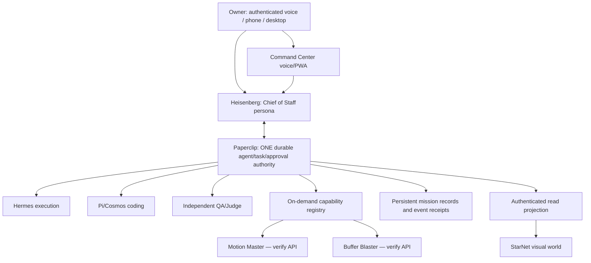

# Architecture, Existing Assets and Consolidation Decisions

## One authority, multiple execution engines

**Important:** This is a target design, not a diagram of verified production connections. The operator must trace actual deployed versions and authenticated interfaces before implementing. Paperclip should run persistently on the server; StarNet frontend should not be the sole runtime authority.

## Verified code-inspection findings (GitHub connector, November 13, 2026)

| Repository | Observed code/documents | Intended decision | Proof still required |
|---|---|---|---|
| `executiveusa/pauli-starnet` | Local-first agent harness, sidecar, Night Shift, crew, MCP, StarNet gateway and workforce service | USE: visual projection, Heisenberg persona, tools as adapters | Real deployment SHA, auth, actual agent flow |
| `executiveusa/pauli-hermes-agent` | Hermes runtime, subagents, gateway and orchestrator/README | USE: execution worker | Current running service and task transport |
| `executiveusa/pauli-pi-agent` | Existing software factory, ICM, `paperclip/company/` agent definitions, approval policies, routines | USE/MERGE: worker plus company configuration | Supported Paperclip import schema, production worker bridge |
| `executiveusa/pauli-studio-control-plane` | `PAPERCLIP.md` proposes deployment, fleet/observe adapters | MERGE useful adapter code; avoid independent management authority | Whether Paperclip was subsequently installed |
| `executiveusa/pauli-command-center` | Documented mobile/voice interface and security hardening audit | USE after actual production verification | Correct deployment/auth and phone test |
| `executiveusa/macs-starnet-` | Existing repo; not fully audited | AUDIT | Overlap and dependencies |
| `executiveusa/open-agent-platform-pauli` | Existing repo; not fully audited | AUDIT | Whether it runs live workflows |
| `executiveusa/crownandcorestarnet` | Named existing collaboration/knowledge repo | AUDIT | Company-specific integrations and authority |

## Concrete observed code gaps

- `pauli-starnet/gateway/workforce-server.js` stores records in an in-memory `Map()`. Restart loses this gateway's records. This is separate from other existing StarNet persistence mechanisms.
- `pauli-starnet/gateway/missions.js` stores mission JSON on disk but the reviewed GREEN path accepts only read-scoped permissions. Other work enters `needs_human`.
- `pauli-starnet/sidecar/workforce/index.js` describes agent blueprints and plans missions; a mission planning response is not proof of end-to-end worker completion.
- `pauli-pi-agent/paperclip/company/agents.yaml` listed 16 role definitions and budgets. Configured roles are NOT proof of 16 live workers.
- `pauli-studio-control-plane/PAPERCLIP.md` states Paperclip was not deployed **when that document was authored**, not necessarily now.
- `pauli-command-center/AUDIT_WIRING_2026-08-29.md` documented production/voice and approval-wiring blockers. Reinspect latest production before making claims.

## Deployment policy

| Service class | Preferred location | Policy |
|---|---|---|
| Paperclip and state | Existing private VPS/Coolify where supported | Always available, backed up, authenticated |
| Heisenberg adapter / event bridge | Private VPS | Always available but lightweight |
| Hermes/Pi/QA execution | Isolated existing worker environments | Wake on demand; retain receipts |
| StarNet frontend | Windows desktop or supported frontend | Optional viewer; must not gate overnight work |
| StarNet status bridge | Authenticated private gateway | Never expose raw localhost sidecar |
| Command Center | Existing authenticated PWA | Owner command/voice/approval interface |
| Video/image/other capability containers | Existing approved compute | Dormant until task and stop afterward |

## Consolidation discipline

First record every service's actual entrypoint, port, owner, restart policy, environment, database, dependencies, active mission IDs, and safe rollback. Distinguish code existence from running infrastructure. Any competing orchestrator should be: (a) retained as an adapter, (b) migrated to canonical Paperclip state, (c) stopped only after live parity tests and explicit approval, or (d) marked unknown/blocked. Never delete unknown data or disable healthy client services during this migration.

## Exactly three active workstreams

1. **Revenue:** one existing sellable offer with a realistic 30-day revenue path.
2. **Shared platform:** STARFACTORY-001, the single management and execution integration.
3. **Bounded experiment:** one verified on-demand specialist integration (prefer low-cost capability).

Everything else is PARK until these priorities are validated. New active work must say what it displaces.